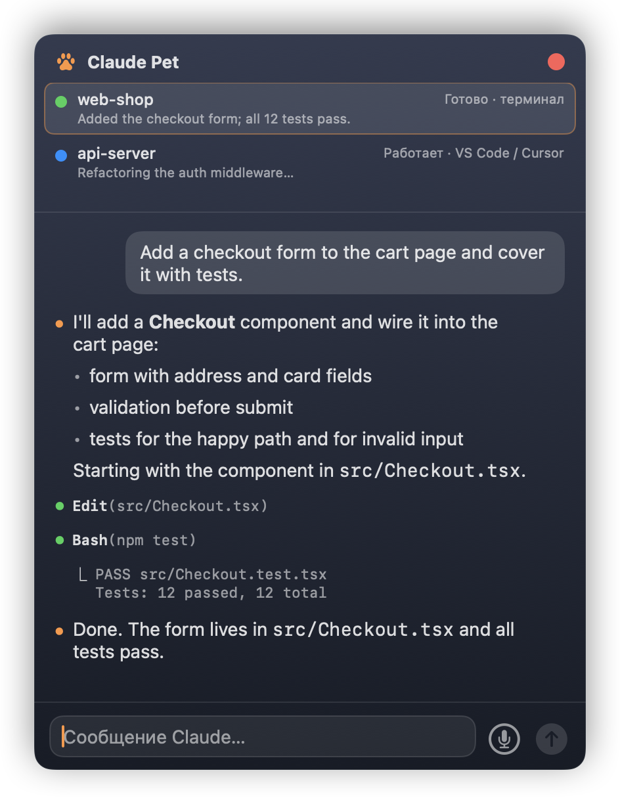
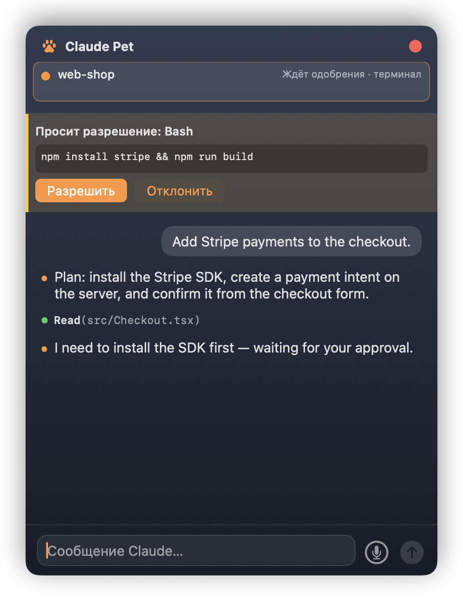

# Claude Pet

A desktop pet for [Claude Code](https://code.claude.com) on macOS. Anna lives above your windows and shows what your Claude Code sessions are doing — working, waiting for approval, done — and a click opens a quick chat with the current session. Works with sessions in the terminal and in the VS Code / Cursor extension.

<p align="center">
  
</p>

<p align="center">
  
  &nbsp;
  
  &nbsp;
  
</p>

<p align="center"><sub>Quick Chat and approvals (sample data) · the 5-hour usage badge under Anna's feet</sub></p>

## What it does

- **Status at a glance.** Anna types on a laptop while Claude works, waves when a session needs your approval, cheers when it's done. With several sessions, the most urgent one wins: needs approval → error → a session that just finished → working → older finished ones.
- **Menu bar.** Every session with its folder, source (terminal / VS Code) and status; system notifications when a session needs approval or finishes a task that took 20 s or more; clicking one opens that session's chat.
- **Quick Chat.** Click Anna: the session's conversation as Claude Code shows it (full replies with Markdown, tool calls like `Bash(git status)`), a field to send a message, and Allow / Deny buttons for permission requests.
- **Voice** (macOS 26+). The 🎤 next to the send button dictates a message in Russian: the text appears in the field, you check it and send. When Claude finishes answering a dictated message, Anna reads the reply aloud — plain text only, code blocks, tables and tool calls are skipped; ⏹ stops her. Recognition runs on your Mac: the first dictation downloads Apple's Russian speech model (about a minute), audio never leaves the machine.
- **Usage.** The 5-hour subscription limit in a small badge under Anna's feet; hover for the reset time, click to re-read it right away. Only terminal sessions report it, so after the window resets the badge shows "—" until your next request in a terminal; the menu bar item shows the same status.
- Anna walks around when nothing is happening. Drop her anywhere and she stays there; throw her and she falls back to the bottom of the screen. She stays visible above full-screen apps and on every Space.
- **Characters.** Anna has three friends — Kai, Lira and Nova. Pick one in the paw menu → **Персонаж** (Character); the choice is remembered.

Everything runs locally. The app only talks to Claude Code on your machine.

> The app's interface is in Russian for now (labels are given below with translations).

## Requirements

- macOS 14 or later (voice input: macOS 26 or later)
- [Claude Code](https://code.claude.com)
- Xcode Command Line Tools — `xcode-select --install` (full Xcode is **not** needed)
- Rust — `curl https://sh.rustup.rs -sSf | sh` or `brew install rust`
- `jq` — built into macOS 15+; on macOS 14 `brew install jq`
- [Bun](https://bun.sh) — *optional*, needed only for replies and approvals from the pet chat (Channel)

## Install

```bash
git clone https://github.com/Iskandar1211/claude-pet.git
cd claude-pet
./install.sh
```

`install.sh` checks the requirements, builds the app and puts it in `~/Applications/Claude Pet.app`. The first build downloads Rust crates and takes a few minutes. You build it yourself, so macOS doesn't block it as a downloaded app.

On first launch a welcome window offers two steps:

1. **Подключить к Claude Code** (Connect to Claude Code) — required. Adds the pet's hooks to `~/.claude/settings.json` (details below). Restart running Claude sessions to pick them up.
2. **Команда claude-pet** (the `claude-pet` command) — optional. Starts Claude Code with the pet's Channel, so you can reply and approve actions from the pet chat:

   ```bash
   claude-pet          # use instead of `claude` in a terminal
   ```

   If the command isn't found, add `export PATH="$HOME/.local/bin:$PATH"` to `~/.zshrc`.

You can reopen the window from the paw icon in the menu bar → **Настройка…** (Setup).

## What it changes on your Mac

| Where | What | How to undo |
|---|---|---|
| `~/.claude/settings.json` | 7 hook entries (`SessionStart`, `UserPromptSubmit`, `PreToolUse`, `PostToolUse`, `Notification`, `Stop`, `SessionEnd`) next to any existing hooks; `statusLine` replaced by a wrapper that records the 5-hour limit and then runs your previous status line | `./uninstall.sh` or the menu bar item «Подключён ко всем проектам ✓ — отключить…» — removes only the pet's entries and restores your status line |
| `~/.claude-pet/` | hook scripts, session event log, backups of every `settings.json` change | delete the folder |
| `~/.local/bin/claude-pet` | the optional launcher (an existing file of the same name is never overwritten) | `./uninstall.sh` |
| `~/Applications/Claude Pet.app` | the app | `./uninstall.sh` |

Before every change to `settings.json` the previous file is saved to `~/.claude-pet/backups/`. Note: the file is rewritten with keys in alphabetical order (same content).

### Security model

- Everything is local: no network ports are opened by the app; the optional Channel listens on `127.0.0.1` only, on a random port, guarded by a per-process token.
- Microphone and speech recognition access is asked once. The app's signature is tied to its bundle id (`local.claude-code-pet`) rather than to the binary hash, so a rebuild keeps the permission — and, like the tokens below, any app you build with that id gets it too.
- Tokens that let the pet send messages and approvals into your sessions live in `~/.claude-pet/` (mode `700`/`600`). **Any process running as your user can read them**, so it could send messages to your Claude sessions — the same trust level as your other dotfiles.
- Conversation text from transcripts is untrusted: links and images are stripped, and the approval card shows the full command. If a preview is incomplete, **Разрешить** (Allow) is disabled and you answer in the terminal.
- Backups in `~/.claude-pet/backups/` are copies of your `settings.json` and may contain secrets from its `env` section; delete them if you rotate keys.

## Uninstall

```bash
./uninstall.sh
```

## How it works

```
Claude Code ──hooks──▶ ~/.claude-pet/events.jsonl ─┐
     ▲   transcripts (~/.claude/projects/…) ───────┤
     │                                             ▼
     │   inbox socket / Channel (MCP)  ◀──  pet-bridge (Rust)  ──JSON lines──▶  Claude Pet.app (Swift, SpriteKit)
     └─────────────────────────────────────────────┘
```

- **Hooks** (`prototype/hooks/log-event.sh`) log session events; **`pet-bridge`** (`bridge/`) builds the session list and statuses from them and reads conversation history from Claude Code transcripts.
- **The app** (`app/`) starts `pet-bridge serve` as a child process and talks to it over stdin/stdout — no network ports. Protocol: [`bridge/PROTOCOL.md`](bridge/PROTOCOL.md).
- **Sending messages**: through the pet's [Channel](https://code.claude.com/docs/en/channels-reference) (`prototype/channel/`, compiled into the app with Bun) when the session was started with `claude-pet`, otherwise through Claude Code's per-session inbox socket.

## Limitations

- **Channels are a research preview** of Claude Code and need `--dangerously-load-development-channels`; `claude-pet` passes it for you. They work only in interactive terminal sessions — not in the VS Code / Cursor extension, so approvals there stay in the IDE (the pet shows "waiting for approval in IDE").
- **The inbox socket format is undocumented** and may change with Claude Code updates. Messages sent this way appear in the session as coming from "another Claude session".
- **The 5-hour limit** is reported only by terminal sessions (the status line doesn't run in the IDE panel).
- The **error** status is not reported yet.
- Tested with Claude Code 2.1.306 on macOS 26.

## Development

```bash
app/scripts/build_app.sh                    # build app/build/Claude Pet.app
open "app/build/Claude Pet.app"
cd bridge && cargo test                     # bridge tests
```

- `app/` — Swift (SwiftPM, no Xcode project): pet window, SpriteKit animations, Quick Chat (SwiftUI).
- `bridge/` — Rust: session registry, transcript reader, installer, `serve` protocol.
- `prototype/hooks/`, `prototype/channel/` — hook scripts and the Channel MCP server.
- Anna's sprite sheet: `app/assets/Anna_source.png` → `app/scripts/key_background.py` → `app/Resources/Anna.png`.
- README images (`docs/`): `app/scripts/make_gif.py` (Anna's states from the sprite sheet), `app/scripts/render_screenshots.sh` (Quick Chat with sample data), `app/scripts/make_icon.py` (app icon).

## Credits

- Pet behavior and the sprite sheet format follow [WindowPet](https://github.com/SeakMengs/WindowPet) (MIT).
- Anna was generated with AI for this project; see [`app/ATTRIBUTION.md`](app/ATTRIBUTION.md).

## License

MIT
